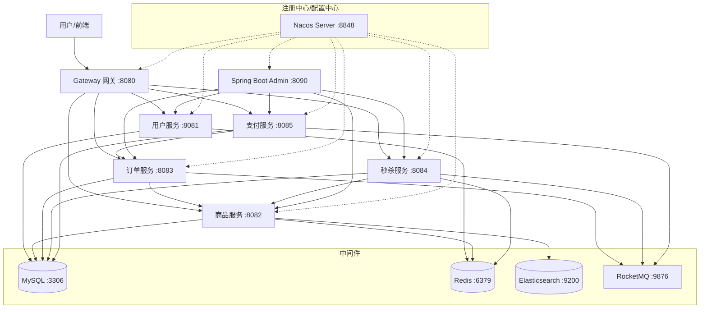

# 微服务架构电商平台

> 从 0 到 1 搭建的微服务电商平台，包含用户、商品、订单、秒杀、支付五大核心服务。  
> 简历项目，技术栈覆盖 Spring Cloud Alibaba 全栈生态。

---

## 目录

- [架构图](#架构图)
- [技术栈](#技术栈)
- [模块说明](#模块说明)
- [快速启动](#快速启动)
- [接口概览](#接口概览)
- [项目亮点](#项目亮点)
- [实测验证](#实测验证)
- [踩坑与修复记录](#踩坑与修复记录)
- [压测数据](#压测数据)

---

## 架构图



---

## 技术栈

| 层级 | 技术 | 版本 |
|------|------|------|
| 框架 | Spring Boot | 3.2.5 |
| JDK | Oracle JDK | 17+ |
| 微服务 | Spring Cloud Alibaba | 2023.0.1 |
| 注册/配置中心 | Nacos | 2.3.0 |
| 网关 | Spring Cloud Gateway | — |
| ORM | MyBatis-Plus | 3.5.5 |
| 数据库 | MySQL | 8.0 |
| 缓存 | Redis | 7.0 |
| 搜索 | Elasticsearch | 7.17 |
| 消息队列 | RocketMQ | 5.1.4 |
| 分布式锁 | Redisson | 3.29 |
| 服务容错 | Sentinel | — |
| 监控 | Spring Boot Admin | 3.2.3 |
| 工具集 | Hutool | 5.8 |
| JWT | JJWT | 0.12 |

---

## 模块说明

| 模块 | 端口 | 说明 |
|------|------|------|
| `gateway` | 8080 | 统一网关，路由转发、跨域、鉴权 |
| `common` | — | 公共模块：响应体、异常、JWT 工具、配置 |
| `ecommerce-admin` | 8090 | Spring Boot Admin 监控面板 |
| `service-user` | 8081 | 用户服务：注册/登录/JWT/RBAC 权限 |
| `service-product` | 8082 | 商品服务：CRUD/ES搜索/Redis缓存 |
| `service-order` | 8083 | 订单服务：状态机/Feign/延迟取消 |
| `service-seckill` | 8084 | 秒杀服务：Redis+Lua/MQ削峰/限流 |
| `service-payment` | 8085 | 支付服务：沙箱对接/回调幂等 |

---

## 快速启动

### 前置条件

- JDK 17+
- Maven 3.9+
- Docker Desktop（用于运行中间件）
- Navicat（管理 MySQL，可选）

### 1. 启动中间件

```bash
# 启动所有中间件（第一次会拉取镜像，较慢）
docker compose -f ecommerce-platform/docker-compose.yml up -d

# 确认全部 running
docker compose ps
```

> ⚠️ **本机环境注意事项**（踩坑总结，见文末[踩坑与修复记录](#踩坑与修复记录)）：
> 1. **本机已装 MySQL 占 3306 端口**时，docker 里的 `mysql` 容器会起不来——本项目服务写死连 `localhost:3306`，**直接用本机 MySQL 即可**（docker 只跑 redis/nacos/rocketmq/es/kibana）。以后启动中间件用：
>    ```bash
>    docker compose up -d redis nacos rmq-namesrv rmq-broker rmq-dashboard elasticsearch kibana
>    ```
> 2. **RocketMQ broker 首次启动报 `NullPointerException`（假象）**：根因是 Docker Desktop 的 named volume 挂载点属主为 root、broker 以 rocketmq 用户运行无写权限。重建 volume 后需执行一次：
>    ```bash
>    docker run --rm -v ecommerce-platform_broker-data://home/rocketmq/store --user root apache/rocketmq:5.1.4 chown -R rocketmq:rocketmq //home/rocketmq/store
>    ```
> 3. **不要重复启动多套服务**：`start-all.bat` 和手动 `java -jar` 会各自拉起一套进程，秒杀服务的 Redisson 锁跨实例互斥会导致随机"请勿重复下单"。

### 2. 初始化数据库

用 Navicat 连接 `localhost:3306`（root / 123456），运行：

```
文件 → 运行SQL文件 → 选择 docs/init.sql → 执行
```

### 3. 启动服务

**方式一：一键启动（推荐）**

```bash
cd ecommerce-platform
start-all.bat
```

会自动编译 + 依次启动所有服务，按任意键关闭全部。

**方式二：逐个启动**

按顺序启动（Nacos 就绪后）：

```bash
# 编译全部模块
mvn -f ecommerce-platform/pom.xml clean package -DskipTests

# 启动各个服务（每个开一个终端，或使用 IDE 启动类）
java -jar ecommerce-platform/ecommerce-admin/target/ecommerce-admin-1.0.0.jar
java -jar ecommerce-platform/gateway/target/gateway-1.0.0.jar
java -jar ecommerce-platform/service-user/target/service-user-1.0.0.jar
java -jar ecommerce-platform/service-product/target/service-product-1.0.0.jar
java -jar ecommerce-platform/service-order/target/service-order-1.0.0.jar
java -jar ecommerce-platform/service-seckill/target/service-seckill-1.0.0.jar
java -jar ecommerce-platform/service-payment/target/service-payment-1.0.0.jar
```

### 4. 验证

| 地址 | 说明 |
|------|------|
| `http://localhost:8080` | 网关 |
| `http://localhost:8848/nacos` | Nacos 控制台（服务注册列表） |
| `http://localhost:8090` | Admin 监控面板（admin/admin123） |
| `http://localhost:8088` | RocketMQ Dashboard |
| `http://localhost:5601` | Kibana |

---

## 接口概览

所有请求通过 Gateway（`:8080`）转发，Prefix 统一为 `/api`。

### 用户服务

| 方法 | 路径 | 说明 | 需登录 |
|------|------|------|--------|
| POST | `/api/user/register` | 注册 | ❌ |
| POST | `/api/user/login` | 登录 | ❌ |
| POST | `/api/user/refresh` | 刷新 Token | ❌ |
| POST | `/api/user/logout` | 登出 | ✅ |
| GET | `/api/user/info` | 当前用户信息 | ✅ |

### 商品服务

| 方法 | 路径 | 说明 | 需登录 |
|------|------|------|--------|
| GET | `/api/product/spu/page` | 商品分页 | ❌ |
| GET | `/api/product/spu/{id}` | 商品详情 | ❌ |
| POST | `/api/product/search` | ES 搜索商品 | ❌ |
| POST | `/api/product/spu` | 创建商品 | ✅ |
| PUT | `/api/product/spu` | 更新商品 | ✅ |
| PUT | `/api/product/spu/{id}/status` | 上下架 | ✅ |

### 订单服务

| 方法 | 路径 | 说明 | 需登录 |
|------|------|------|--------|
| POST | `/api/order` | 创建订单 | ✅ |
| GET | `/api/order/{id}` | 订单详情 | ✅ |
| GET | `/api/order/page` | 我的订单列表 | ✅ |
| POST | `/api/order/{id}/cancel` | 取消订单 | ✅ |

### 秒杀服务

| 方法 | 路径 | 说明 | 需登录 |
|------|------|------|--------|
| POST | `/api/seckill` | 秒杀下单 | ✅ |
| GET | `/api/seckill/activities` | 秒杀活动列表 | ❌ |
| GET | `/api/seckill/stock/{activityId}/{skuId}` | 实时库存 | ❌ |
| POST | `/api/seckill/warm-up/{activityId}` | 预热库存 | ✅ |

### 支付服务

| 方法 | 路径 | 说明 | 需登录 |
|------|------|------|--------|
| POST | `/api/payment` | 创建支付 | ✅ |
| POST | `/api/payment/notify` | 支付回调 | ❌（支付宝回调） |

---

## 项目亮点

### 秒杀系统（核心亮点）

```
请求 → Gateway(Sentinel限流) → 验证活动 → Lua原子扣库存
     → Redisson防重复 → MQ异步削峰 → 异步创建订单
```

- **Redis + Lua 脚本** 实现库存扣减原子性，消除超卖
- **RocketMQ 异步削峰** 将瞬时高并发流量打散为平滑消费
- **Redisson 分布式锁** 防止同一用户重复下单
- **Sentinel 限流**（依赖与配置已接入，流控规则待部署 dashboard 后启用）

### Redis 缓存三防

- **击穿**：Redisson 分布式锁 + 双重检测
- **穿透**：空值缓存（短 TTL 60s）
- **雪崩**：随机过期时间（基础 TTL + 0~300s 随机偏移）

### 订单状态机

基于 Map 驱动的状态机，严格校验状态转换合法性：

```
待支付 ──→ 已支付 ──→ 已发货 ──→ 已完成
  │
  └──→ 已取消（用户主动 / 30分钟超时自动）
```

---

## 实测验证

> 2026-08-13 全链路从零到一实机跑通（本机 MySQL + Docker 中间件），逐环节验证通过：

| # | 环节 | 结果 |
|---|------|------|
| 1 | 用户登录（普通用户 + 管理员） | ✅ JWT 签发/解析正常 |
| 2 | 商品浏览 | ✅ 分页/详情正常 |
| 3 | 下单 | ✅ 订单创建，Feign 取真实价格 |
| 4 | 取消订单（待支付） | ✅ 状态机流转 + Feign 恢复库存 |
| 5 | 支付（createPay + 回调验签） | ✅ HMAC 验签通过，订单 → 已支付 |
| 6 | 秒杀预热（管理员） | ✅ ADMIN 权限校验 |
| 7 | 秒杀 | ✅ Lua 扣库存 → MQ 削峰 → 异步建单 |

完整测试流程见 `docs/testing.md`。

---

## 踩坑与修复记录

> 开发/联调中发现并已修复的关键问题，作为复盘与面试素材。全部已提交并推送。

### 1. JwtAuthFilter 未填充 SecurityContext → 业务接口全 401（P0）

**现象**：登录、浏览正常，但下单/秒杀/支付等需登录接口一律返回 401。

**根因**：除 `service-user` 外，其余 4 个服务的 `JwtAuthFilter` 只 `request.setAttribute("userId")`，没有把身份写入 `SecurityContextHolder`。而各服务 `SecurityConfig` 都配了 `anyRequest().authenticated()`，Spring Security 的授权决策读的是 SecurityContext，匿名身份被 `authenticated()` 拒绝。

**修复**：过滤器解析 Token 后构造 `UsernamePasswordAuthenticationToken` 塞进 `SecurityContextHolder`（seckill 额外映射 `ROLE_ADMIN`）。

### 2. SecurityConfig 非法路径模式 `/**/pay` → PatternParseException（P0）

**现象**：order 服务任何请求都返回 401 "Token无效"（异常被 JwtAuthFilter 静默 catch 吞掉，伪装成 Token 问题）。

**根因**：`requestMatchers("/api/order/**/pay")` 里 `/**` 后面还跟 `/pay`——Spring 6 的 `PathPatternParser`（MvcRequestMatcher 底层）**不允许 `**` 后跟其他模式元素**，解析时抛 `PatternParseException`。

**修复**：改为 `/api/order/*/pay`（单段通配）。同时给 JwtAuthFilter 的 catch 补上 `log.error`（原静默吞异常导致排查困难）。

### 3. 秒杀 lockKey 与 orderedKey 同 key → 永远"请勿重复下单"（P0）

**现象**：秒杀永远返回 4003 请勿重复下单，从未成功。

**根因**：`SeckillService` 里分布式锁 key 和"已下单"去重 key 都用 `ORDERED_PREFIX + activityId:skuId:userId` 拼接——**tryLock 刚创建的锁，紧接着 `hasKey` 检查就命中，100% 误判为已下单**。

**修复**：新增独立 `LOCK_PREFIX = "seckill:lock:"`，锁 key 与去重 key 分离。定位手段：Redis `MONITOR` 抓命令 + 打日志确认 `REPEAT@orderedKey` 分支。

### 4. Redisson codec 序列化 Lua 参数 → "compare number with nil"（P0）

**现象**：秒杀 Lua 脚本报 `ERR attempt to compare number with nil`。

**根因**：seckill 的 `RedisTemplate` 实际是 `RedissonConnectionFactory`（Redisson 自动配置替换），Redisson 默认 codec 会把 `ARGV["1"]` 等参数序列化，Lua 里 `tonumber(ARGV[1])` 拿到 nil。手动 EVAL 明文参数可成功，对照实验定位。

**修复**：改用 `StringRedisTemplate`（String 序列化，key/value/args 均为明文，与 Lua `tonumber` 兼容）。

### 5. 环境类坑（不影响代码，但启动必踩）

- **3306 端口冲突**：本机 MySQL 占 3306，docker mysql 容器起不来；服务写死 localhost:3306，直接用本机 MySQL。
- **RocketMQ broker 假 NPE**：Docker Desktop named volume 属主为 root，broker 无写权限 → store 初始化失败，异常被 shutdown 的 NPE 掩盖。
- **双实例**：多套服务进程并存时 Redisson 锁跨实例互斥，秒杀随机判重。
- **localhost 解析**：Java 解析 `localhost` 可能走 IPv6 `::1`（wslrelay），排查 Redis 时需注意与 `127.0.0.1`（docker）区分。

---

## 压测数据

> 压测工具：Apache JMeter
> ⚠️ 压测方案已设计（见 `docs/benchmark.md`），**数据待在实际环境执行后填充**——目前未运行压测，请勿在简历中引用未实测的 QPS 数字。

| 场景 | 并发数 | QPS | P99 RT | 错误率 |
|------|--------|-----|--------|--------|
| 商品详情（无缓存） | 500 | 待实测 | 待实测 | 待实测 |
| 商品详情（有缓存） | 500 | — | — | — |
| 秒杀下单（无 MQ 削峰） | 1000 | — | — | — |
| 秒杀下单（MQ 削峰） | 5000 | — | — | — |
| 全链路混合压测 | 2000 | — | — | — |

---

## 项目结构

```
ecommerce-platform/
├── docker-compose.yml           # 中间件编排
├── pom.xml                      # Maven 父工程
├── docs/
│   ├── init.sql                 # 全量建库建表脚本
│   └── benchmark.md             # 压测方案
├── common/                      # 公共模块
├── gateway/                     # 网关
├── ecommerce-admin/             # Spring Boot Admin 监控
├── service-user/                # 用户服务
├── service-product/             # 商品服务
├── service-order/               # 订单服务
├── service-seckill/             # 秒杀服务
└── service-payment/             # 支付服务
```
